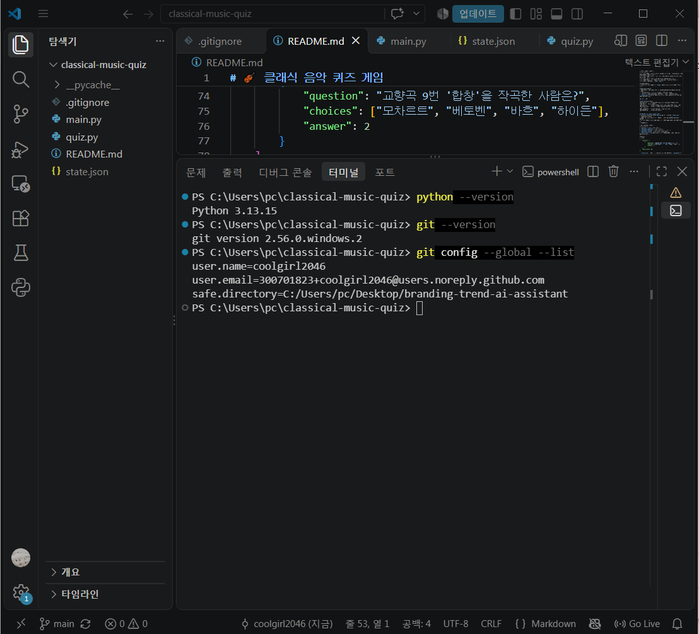
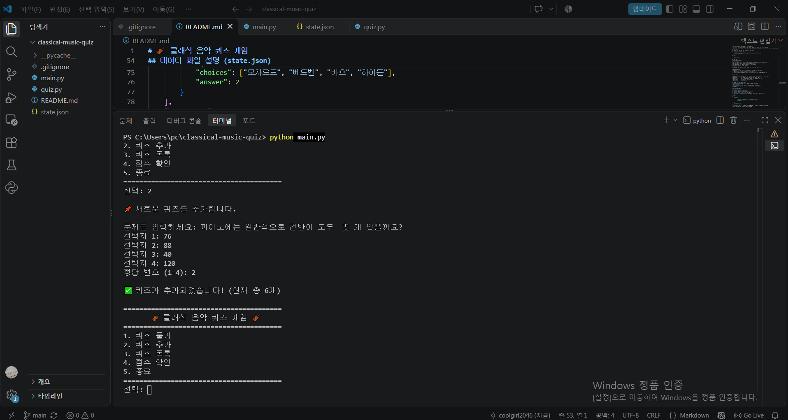
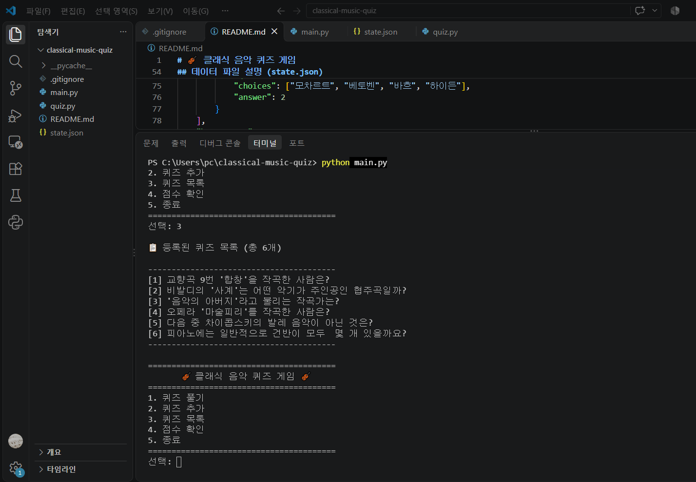
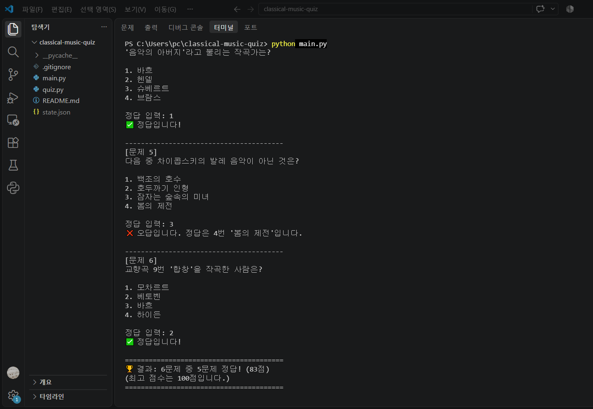
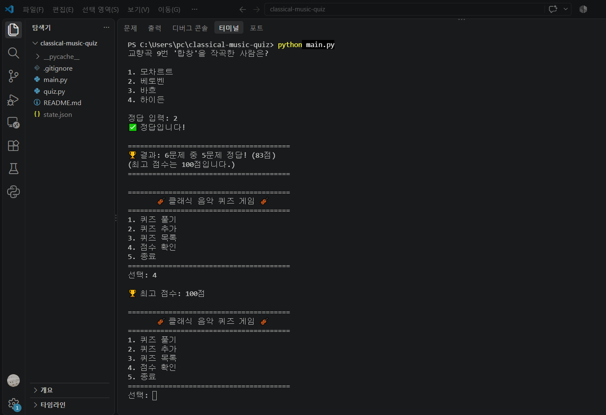
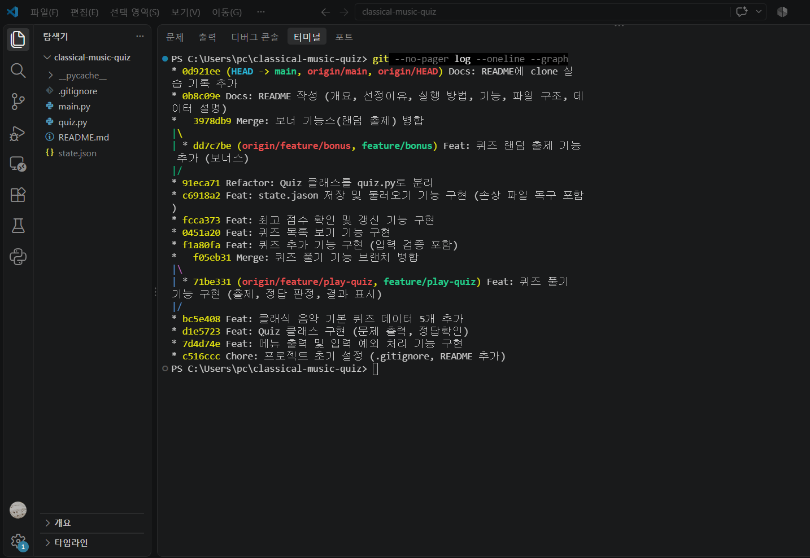

# 🎻 클래식 음악 퀴즈 게임

## 프로젝트 개요
터미널에서 실행하는 클래식 음악 퀴즈 게임입니다.
Python 기본 문법과 클래스(Quiz, QuizGame)로 역할을 나누고,
퀴즈와 최고 점수를 `state.json` 파일에 저장해 프로그램을 다시 실행해도 데이터가 유지됩니다.
변경 이력은 Git으로 기능 단위 커밋, 브랜치 생성·병합을 통해 관리했습니다.

## 퀴즈 주제와 선정 이유
- **주제**: 클래식 음악 (작곡가, 대표곡, 악기 등)
- **선정 이유**: 피아노를 전공했고, 아이들에게 작곡가 퀴즈 수업을 했던 경험이 있습니다.
  그 수업이 떠올라, 익숙하고 애정이 있는 클래식 음악을 주제로 직접 문제를 만들고 추가할 수 있는 퀴즈 프로그램을 만들어 보았습니다.

## 실행 방법
1. Python 3.10 이상 설치 (외부 라이브러리 필요 없음)
2. 저장소 복제 후 폴더로 이동
   ```
   git clone https://github.com/coolgirl2046/classical-music-quiz.git
   cd classical-music-quiz
   ```
3. 실행
   ```
   python main.py
   ```

## 기능 목록
| 메뉴 | 기능 | 설명 |
|---|---|---|
| 1 | 퀴즈 풀기 | 등록된 퀴즈를 무작위 순서로 풀고, 정답/오답과 최종 점수(100점 만점)를 표시 |
| 2 | 퀴즈 추가 | 문제, 선택지 4개, 정답 번호를 입력해 새 퀴즈 등록 후 파일에 저장 |
| 3 | 퀴즈 목록 | 등록된 퀴즈의 문제를 번호와 함께 표시 |
| 4 | 점수 확인 | 최고 점수 표시 (아직 풀지 않았으면 안내) |
| 5 | 종료 | 데이터를 저장하고 종료 |

**보너스 기능**
- 랜덤 출제: 퀴즈 풀기 시 `random` 모듈로 문제 순서를 매번 섞어서 출제

**입력/예외 처리**
- 숫자 입력: 앞뒤 공백 제거, 빈 입력·문자·범위 밖 숫자는 안내 후 재입력
- 글자 입력(문제, 선택지): 빈 입력은 안내 후 재입력
- `Ctrl+C` / 입력 종료(EOF): 데이터를 저장하고 안전하게 종료
- `state.json`이 없으면 기본 퀴즈 5개로 시작, 손상되었으면 안내 후 기본 데이터로 복구

## 파일 구조
```
classical-music-quiz/
├── main.py       # 프로그램 시작 파일, QuizGame 클래스 (메뉴, 게임 진행, 저장/불러오기)
├── quiz.py       # Quiz 클래스 (문제 출력, 정답 확인, dict 변환)
├── state.json    # 실행 시 자동 생성되는 데이터 파일 (Git에는 올리지 않음)
├── .gitignore    # Git이 기록하지 않을 파일 목록
├── docs/
│   └── screenshots/  # 실행 화면 캡처 이미지
└── README.md     # 프로젝트 설명서
```

## 데이터 파일 설명 (state.json)
- **경로**: 프로젝트 루트(`main.py`와 같은 폴더)의 `state.json`
- **인코딩**: UTF-8
- **역할**: 퀴즈 목록과 최고 점수를 저장해 프로그램을 종료해도 데이터 유지
- **저장 시점**: 퀴즈 추가 직후, 최고 점수 갱신 직후, 프로그램 종료 시
- **스키마**

| 키 | 자료형 | 설명 |
|---|---|---|
| `quizzes` | list | 퀴즈 목록 |
| `quizzes[].question` | str | 문제 |
| `quizzes[].choices` | list (str 4개) | 선택지 |
| `quizzes[].answer` | int (1~4) | 정답 번호 |
| `best_score` | int 또는 null | 최고 점수(100점 만점), 아직 안 풀었으면 null |

**예시**
```json
{
    "quizzes": [
        {
            "question": "교향곡 9번 '합창'을 작곡한 사람은?",
            "choices": ["모차르트", "베토벤", "바흐", "하이든"],
            "answer": 2
        }
    ],
    "best_score": 80
}
```
- `state.json`은 실행할 때마다 바뀌는 개인 데이터라 `.gitignore`로 Git에서 제외했습니다.
- clone 실습: 복제한 저장소에서 추가한 줄입니다.

## 📸 실행 화면

### 개발 환경


### 퀴즈 추가


### 퀴즈 목록


### 퀴즈 풀기 (랜덤 출제)


### 점수 확인


### Git 커밋 그래프
